# NucGuessr — Choix de la direction artistique (phase 3)

**Proposition : direction A « Synoptique »**, avec la palette « Tcherenkov », la paire IBM Plex Sans + IBM Plex Mono et une **barre de temps linéaire graduée**. Les métaphores restent légères : le score se lit comme un relevé d'instrument et l'écran de fin comme un compte rendu d'essai.

> ⚠️ **À valider avec la promo** (voir la dernière section). Le choix ci-dessous est celui des tests ; la promo tranche.

Tous les prototypes sont des fichiers HTML autonomes : on les ouvre par un double-clic (polices et tokens embarqués). Sans paramètre, l'écran est **jouable** : tapez « Tric » puis `Tab` et `Entrée`, ou essayez « Cruas » pour voir la secousse et le −2 s. Les paramètres d'URL (`?t=9.6&etat=erreur`, `&typo=jetbrains`, `&palette=graphite`, `&barre=expo`) figent un état pour les captures.

| Fichier | Contenu |
|---|---|
| [`direction-a-synoptique.html`](direction-a-synoptique.html) | Direction A, avec les variantes de typo, de palette et de barre de temps |
| [`direction-b-plan.html`](direction-b-plan.html) | Direction B |
| [`fin-compte-rendu.html`](fin-compte-rendu.html) | Esquisse de l'écran de fin dans la direction A |
| [`carte-style.svg`](carte-style.svg) | Échantillon du style de carte du mode Distance |
| [`MOODBOARD.md`](MOODBOARD.md), [`TOKENS.md`](TOKENS.md) | Références ; guide d'usage des tokens pour les phases 4 à 6 |

---

## 1. Les deux directions

### A « Synoptique » (salle de commande)

Bandeau d'instrumentation en haut (round et voyants, score), photo cadrée comme un moniteur (repères d'angle, légende de canal), **pupitre** à droite (champ de saisie, suggestions, essais barrés, journal des rounds), chrono et barre graduée sous la photo. Filets de 1 px, libellés en petites capitales à chasse fixe, coins quasi droits, aucun dégradé ni ombre. Mise en page asymétrique.

| | Bureau 1280 × 800 | Mobile 360 × 400 (clavier ouvert) |
|---|---|---|
| En jeu (« Tric » tapé) | 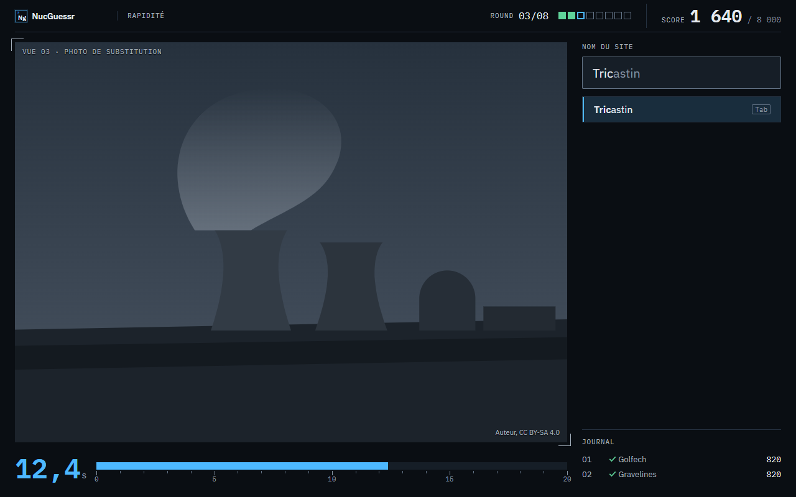 | 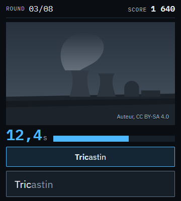 |
| Mauvaise réponse | 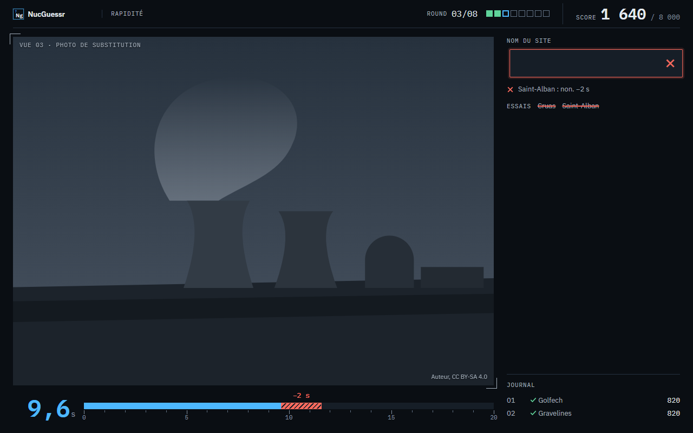 | 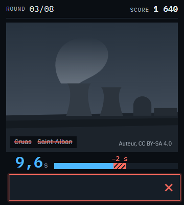 |
| Bonne réponse / dernières secondes | 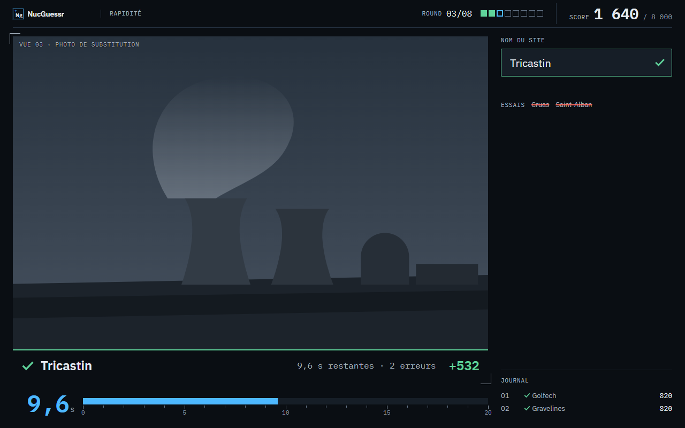 | 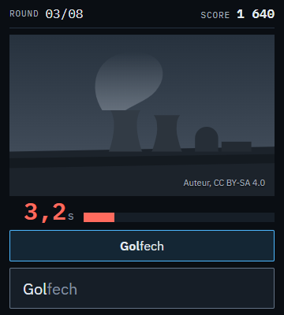 |

Round perdu : [`captures/a-perdu-bureau.png`](captures/a-perdu-bureau.png).

### B « Plan technique » (cadre de dessin, cotes, cartouche)

Fond quadrillé façon carte des nucléides, cadre de plan avec repères de zone (1-6, A-D), photo surmontée d'une cote « 20,0 s » qui sert d'échelle, **temps restant affiché comme une cote** sous la photo (le chiffre est posé au milieu de la cote et se déplace avec elle), champ « Désignation du site » souligné, cartouche en bas à droite (folio, score, essais).

| | Bureau 1280 × 800 | Mobile 360 × 400 |
|---|---|---|
| En jeu | 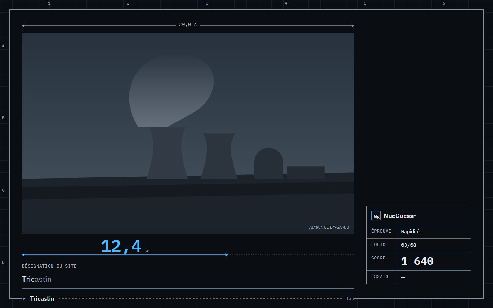 | 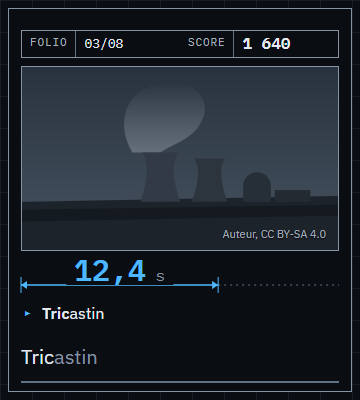 |
| Mauvaise réponse | 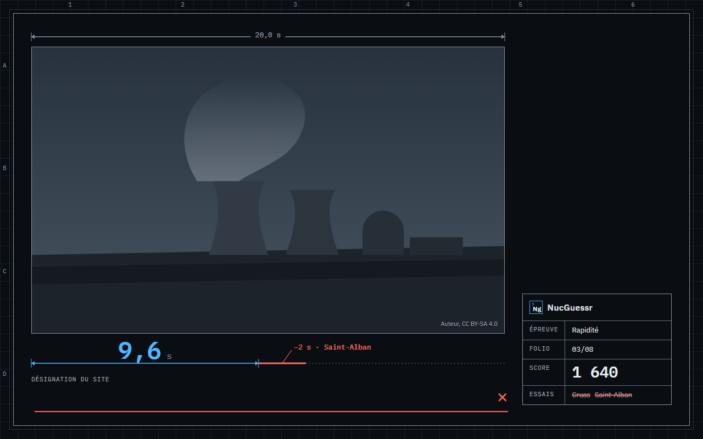 | 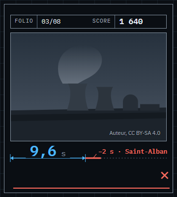 |

## 2. Test « lisibilité à 20 s de jeu »

Mesures prises dans le navigateur (Edge sans tête, `design/outils/capturer.mjs`, résultats bruts dans [`tests/mesures.json`](tests/mesures.json)) :

| Critère | A Synoptique | B Plan technique |
|---|---|---|
| Part de l'écran occupée par la photo, bureau | **56 %** (888 × 644 px) | 44 % (862 × 523 px) |
| Part de l'écran occupée par la photo, mobile 360 × 400 | **48 %** (336 × 205 px) | 41 % (318 × 185 px) |
| Chrono (taille de police bureau / mobile) | 44 / 30 px | 44 / 30 px |
| Position du chrono | **fixe** (toujours au même endroit) | se déplace avec la cote : il faut le chercher |
| Photo, barre, chrono, champ, suggestions visibles sans défilement à 360 × 400 | oui | oui (après correction : à la première version, les suggestions recouvraient le chrono) |
| Essais barrés visibles sur mobile | oui (posés sur la photo) | non (pas de place dans le cartouche réduit) |
| Liste de suggestions à 1280 × 800 | dans le pupitre, toujours de la place | déborde du cadre en bas de l'écran |
| Saut de −2 s | segment hachuré + « −2 s » au-dessus de la barre | trait rouge + annotation avec ligne de rappel |

**Résultat :** à surface égale, A montre une photo plus grande (+27 % sur bureau, +17 % sur mobile), garde le chrono immobile et a une place naturelle pour les suggestions et les essais. B est le plus original et plaît au premier regard, mais son ornement (cadre, cotes, repères) coûte de la place, et le chrono mobile se lit moins vite. **A est retenue** ; on garde de B le **cartouche et le tableau de relevé**, qui servent l'écran de fin.

## 3. Typographie

Trois paires testées dans le prototype A ([`captures/a-typo-plex-mobile.png`](captures/a-typo-plex-mobile.png), [`…-jetbrains-…`](captures/a-typo-jetbrains-mobile.png), [`…-barlow-…`](captures/a-typo-barlow-mobile.png)) et sur une planche de glyphes ([`tests/glyphes.html`](tests/glyphes.html), capture ci-dessous).

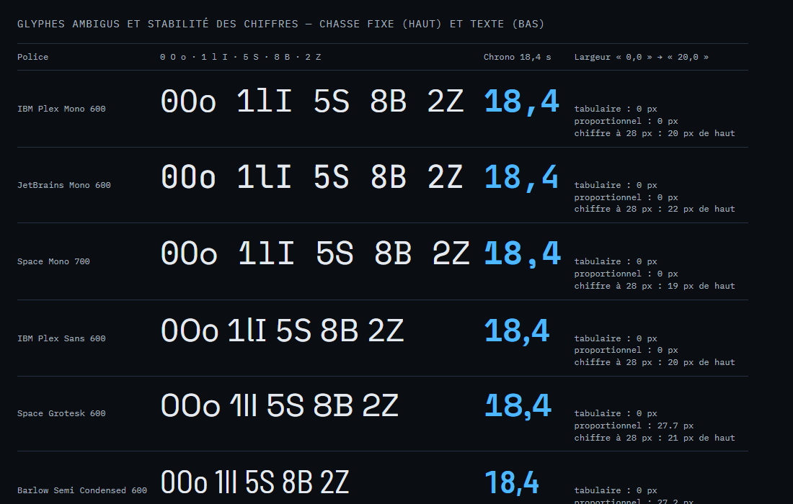

| Police | 0 / O | 1 / l / I | 5 / S | Écart de largeur « 0,0 » → « 20,0 » (chiffres tabulaires) | Hauteur d'un chiffre à 28 px | WOFF2 latin 400 + 600 |
|---|---|---|---|---|---|---|
| **IBM Plex Mono** | zéro pointé ✓ | distincts ✓ | ✓ | 0 px | 20 px | **30 Ko** |
| JetBrains Mono | zéro pointé ✓ | distincts ✓ | ✓ | 0 px | **22 px** | 43 Ko |
| Space Mono | zéro pointé ✓ | distincts, 1 très typé | ✓ | 0 px | 19 px | 33 Ko (400 + 700) |
| IBM Plex Sans (texte) | proches | l et I proches | ✓ | 0 px | 20 px | 47 Ko |
| Space Grotesk (texte) | proches | **I et l identiques** | ✓ | 0 px, mais 27,7 px en chiffres proportionnels | 21 px | 27 Ko |
| Barlow Semi Condensed (texte) | proches | **I et l identiques** | ✓ | 0 px, mais 27,2 px en proportionnels | 20 px | 45 Ko |

**Résultat :** les trois polices à chasse fixe lèvent toutes les ambiguïtés et gardent un chrono parfaitement stable ; les polices de texte, elles, confondent I et l, ce qui confirme la règle « **tous les chiffres en chasse fixe** ». JetBrains Mono a des chiffres 10 % plus hauts, mais Plex Mono est plus légère et forme une vraie famille avec Plex Sans (mêmes proportions, même dessin « industriel ») ; on compense en portant le chrono mobile de 28 à 30 px.

**Retenu : IBM Plex Sans (texte et titres, 400 et 600) + IBM Plex Mono (chiffres et libellés d'instrument, 400 et 600).** 4 fichiers WOFF2, **77 Ko au total** (Sans 22,6 + 24,3 Ko, Mono 14,7 + 15,6 Ko), dans `public/fonts/`, licence OFL à côté. Pas d'italique.

## 4. Palette

Deux palettes testées : **Tcherenkov** (fond bleu nuit `#0a0e13`, accent `#4db8ff`) et **Graphite** (fond neutre `#0d0d0e`, accent plus profond `#3d8bff`, capture [`a-palette-graphite-bureau.png`](captures/a-palette-graphite-bureau.png)). Contraste WCAG calculé par [`tests/contraste.py`](tests/contraste.py), qui lit directement `src/styles/tokens.css` (sortie complète : [`tests/contraste-sortie.txt`](tests/contraste-sortie.txt)).

| Paire (texte / fond) | Tcherenkov | Graphite | Seuil AA |
|---|---|---|---|
| Texte principal / fond | 15,97 | 16,44 | 4,5 |
| Texte secondaire / fond | 8,68 | 8,20 | 4,5 |
| **Texte fantôme** de l'autocomplétion / champ | **5,36** | 4,96 | 4,5 |
| Accent (chrono) / fond | **8,86** | 5,86 | 4,5 |
| Texte du bouton / aplat accent | **8,65** | 3,31 ✕ | 4,5 |
| Succès / fond | 10,39 | 8,77 | 4,5 |
| Erreur / fond | 6,93 | 5,76 | 4,5 |
| Erreur / halo d'erreur | 4,82 | 4,15 ✕ | 4,5 |
| Contour du champ / champ | 3,41 | 2,69 ✕ | 3 (composant) |
| Barre de temps (accent) / rail | 7,70 | 5,13 | 3 (graphique) |

**Résultat :** Tcherenkov passe **toutes** les paires (24 paires notées, 0 échec, carte comprise) ; Graphite en rate 3, et son accent plus sombre se lit moins bien en chrono. Le fond légèrement bleuté accorde aussi l'accent au reste de l'écran. Deux couleurs ont été éclaircies après la première mesure : le contour des champs (`#5a6878` → `#627285`, 2,95 → 3,41) et la frontière de la carte (`#3a4757` → `#56677c`, 2,10 → 3,43).

**Retenu : palette Tcherenkov** (valeurs dans `src/styles/tokens.css`).

## 5. Métaphore de la barre de temps

Trois variantes dans le prototype A (`?barre=lineaire|expo|grappes`), capturées à 15, 10 et 5 s restantes, puis juste avant et juste après une erreur ([`tests/barre_temps.py`](tests/barre_temps.py), sortie : [`tests/barre_temps-sortie.txt`](tests/barre_temps-sortie.txt)) :

| Linéaire graduée | Décroissance exponentielle (τ = 5 s) | 20 barres de contrôle (1 par seconde) |
|---|---|---|
| 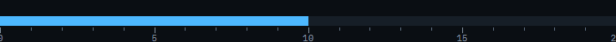 | 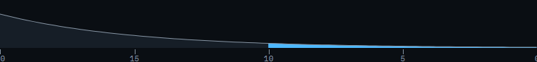 | 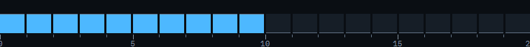 |
| 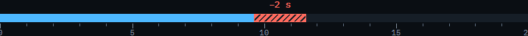 | 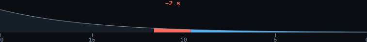 | 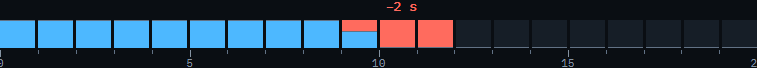 |

La mesure compte les pixels de bleu restants, c'est-à-dire ce que l'œil évalue d'un coup :

| Temps restant | Linéaire | Exponentielle | Barres de contrôle |
|---|---|---|---|
| 15 s (75 %) | 75 % | **32 %** (−8,6 s) | 75 % |
| 10 s (50 %) | 50 % | **9 %** (−8,3 s) | 50 % |
| 5 s (25 %) | 25 % | **1 %** (−4,7 s) | 25 % |
| Part de la barre en rouge juste après une erreur | 7,8 % + « −2 s » | 6,1 % + « −2 s » | 12,2 % + « −2 s » |

**Résultat :** l'exponentielle **ment** : à mi-temps, elle n'affiche plus que 9 % de bleu, le joueur croit avoir perdu alors qu'il lui reste 10 s (et la queue de la courbe rend les 5 dernières secondes invisibles). Elle est écartée. Linéaire et barres de contrôle disent la vérité ; les barres rendent le −2 s plus visible (deux barres qui tombent d'un coup), mais prennent 28 px de haut au lieu de 12, précieux sur mobile, et leur métaphore demande une explication.

**Retenu : barre linéaire** de 12 px, **graduée à chaque seconde** (graduation longue et étiquette toutes les 5 s), qui passe en rouge sous 5 s, avec le chrono numérique à côté. Le segment perdu de 2 s reste affiché **hachuré** en rouge 0,9 s avec « −2 s » au-dessus, puis s'efface. Les graduations à la seconde gardent l'idée des barres de contrôle (on compte les crans) sans en payer le prix.

**Les autres métaphores :**
- **score comme relevé d'instrument** : gardé, en version légère (libellé `SCORE` en petites capitales, valeur en chasse fixe, « / 8 000 » en gris). Pas de compteur qui défile ni de cadran : la valeur doit se lire, pas s'animer ;
- **écran de fin comme compte rendu d'essai** : gardé, en version légère (section 7).

## 6. Daltonisme

[`tests/daltonisme.py`](tests/daltonisme.py) simule la deutéranopie et la protanopie (matrices de Machado et al. 2009, sévérité maximale) sur les captures et sur les couleurs de statut (sortie : [`tests/daltonisme-sortie.txt`](tests/daltonisme-sortie.txt)).

| | Vision normale | Deutéranopie | Protanopie |
|---|---|---|---|
| ΔE succès / erreur | 104 | 28 | 23 |
| ΔE accent / erreur (barre normale / barre en alerte) | 103 | 90 | 66 |

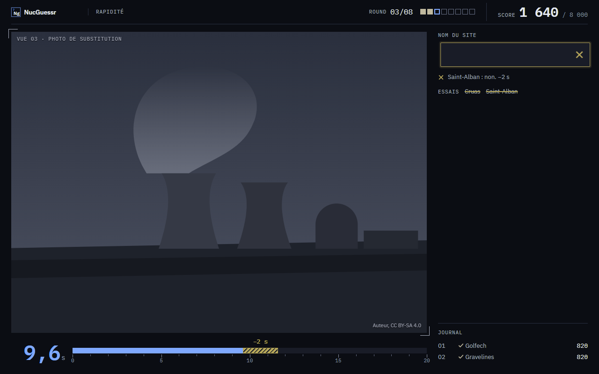

**Résultat :** pour un deutéranope, vert et rouge deviennent deux beiges assez proches (ΔE 28 : différents, mais pas au premier coup d'œil). C'est attendu, et c'est pourquoi **la couleur ne porte jamais seule l'information** : coche ✓ / croix ✕ dessinées en SVG dans le champ, la bande de réponse et le journal ; noms tentés **barrés** ; segment perdu **hachuré** ; « −2 s » et « Temps écoulé » écrits ; voyants de round pleins (réussi) ou avec une croix (perdu). Le passage de la barre en alerte (bleu → rouge) reste très net (ΔE 66 à 90), et le chrono affiche de toute façon la valeur.

## 7. Écran de fin : « compte rendu d'essai », version légère

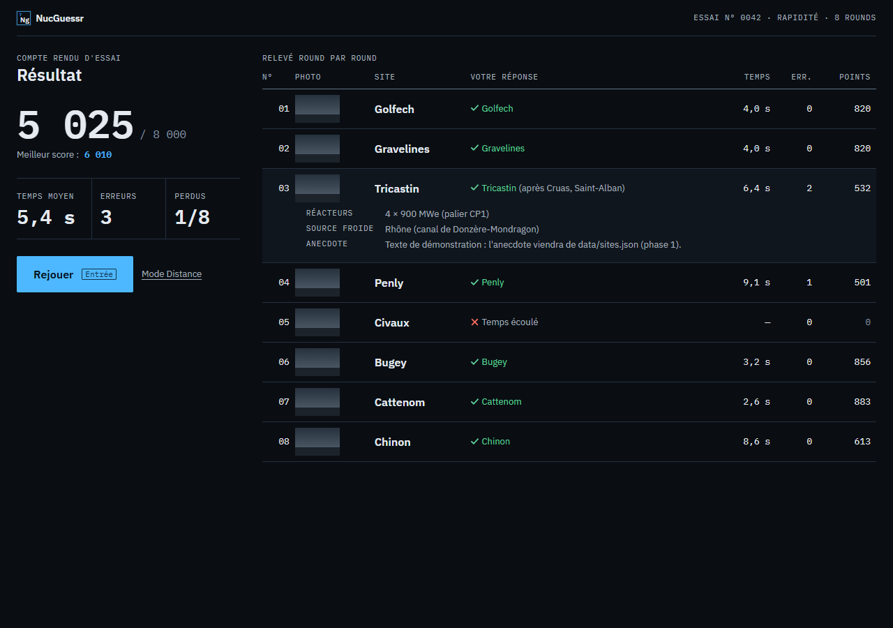

Esquisse : [`fin-compte-rendu.html`](fin-compte-rendu.html) ([mobile](captures/fin-mobile.png)). La métaphore se limite à la **forme** : un en-tête « Compte rendu d'essai · Essai n° 0042 », un total en gros chiffres, trois mesures (temps moyen, erreurs, rounds perdus), puis un **tableau de relevé round par round** (photo, site, votre réponse, temps, erreurs, points) dont chaque ligne se déplie sur la fiche du site. Le bouton « Rejouer » (`Entrée`) est le seul aplat d'accent de l'écran, à gauche, sous le total. Pas de faux tampon, de signature ni de numéro de procédure : au-delà, la métaphore gênerait la lecture.

## 8. Carte du mode Distance


Même langage que l'écran de jeu : **traits fins sur fond sombre**, pas de relief ni de tuiles photographiques. La mer est plus sombre que le fond de page, la terre légèrement plus claire, la frontière en gris moyen (3,43:1 sur la mer). Les fleuves sont d'un bleu désaturé (`#2c5f86`) nettement distinct de l'accent, pour que le repère du joueur reste le seul élément « vivant ». Le **repère du joueur** est un rond plein accent avec un anneau ; la **position réelle** un losange blanc (formes différentes, pas seulement des couleurs) ; le trait entre les deux est en tirets blancs, avec la distance dans une étiquette en chasse fixe.

Tokens (`src/styles/tokens.css`) : `--carte-mer`, `--carte-terre`, `--carte-frontiere` (+ `-epaisseur`), `--carte-limite-region`, `--carte-fleuve` (+ `-epaisseur`), `--carte-ville`, `--carte-marqueur-joueur`, `--carte-marqueur-reponse`, `--carte-trait` (+ `-tirets`, `-epaisseur`), `--carte-cercle-parfait`, `--duree-camera-carte`.

## 9. Identité

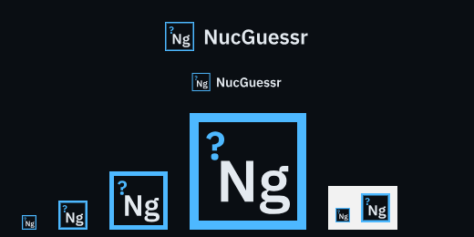

Le symbole est une **case de la carte des nucléides** : un élément fictif « Ng » dont le nombre de masse, en exposant à gauche comme dans ²³⁵U, est « ? » (l'isotope reste à deviner). Le wordmark associe la case (contour accent) et « NucGuessr » en Plex Sans SemiBold. Le texte est converti en tracés (`design/outils/logo.py`), les fichiers ne dépendent d'aucune police.

| Fichier | Usage |
|---|---|
| `src/assets/wordmark.svg` | wordmark en couleurs, fond transparent |
| `src/assets/wordmark-mono.svg` | même dessin en `currentColor`, à insérer en ligne |
| `src/assets/symbole.svg` | case seule |
| `public/favicon.svg`, `public/favicon-32.png`, `public/apple-touch-icon.png` | favicons (sur fond `--c-fond`, lisibles sur un onglet clair) |

## 10. À valider avec la promo

1. **Direction A ou B ?** Montrer les deux prototypes jouables (ouvrir les fichiers HTML) plutôt que les captures. Question : « lequel vous laisse le mieux voir la photo et le temps ? ». Si B plaît beaucoup, on peut reprendre son fond quadrillé et ses cotes sur l'écran d'accueil sans toucher à l'écran de jeu.
2. **Le symbole « ?Ng »** : la blague (élément fictif, isotope inconnu) est-elle comprise ? Alternative simple : la case avec « Nu » ou un wordmark sans symbole.
3. **Le vert de succès** : assez distinct du bleu d'accent pour tout le monde ? (Les daltoniens de la promo sont les meilleurs testeurs.)
4. **La barre en rouge sous 5 s** : tension agréable, ou stress inutile ? (Réglable : `--seuil-alerte-s`, ou supprimer la règle.)
5. **Le chrono** en dixièmes (« 12,4 s ») ou en secondes entières ? Les dixièmes rendent le défilement vivant ; à confirmer en jouant.

## Reproduire les tests

Prérequis hors du dépôt (rien n'est ajouté au `package.json`) : `npm i playwright-core@1.49.1` dans un dossier temporaire (navigateur : Microsoft Edge déjà installé), `pip install --target <temp> fonttools brotli` pour le logo, et les polices candidates via `npm pack @fontsource/<famille>` pour réembarquer les variantes.

```sh
python -I design/outils/embarquer.py design/*.html design/tests/glyphes.html   # NUCG_POLICES_CANDIDATES=<temp> pour les variantes
PW_DIR=<temp> node design/outils/capturer.mjs        # captures + tests/mesures.json
python -I design/tests/barre_temps.py > design/tests/barre_temps-sortie.txt
python -I design/tests/contraste.py   > design/tests/contraste-sortie.txt   # code 1 si une paire échoue
python -I design/tests/daltonisme.py  > design/tests/daltonisme-sortie.txt
PYTHONPATH=<temp> python design/outils/logo.py && PW_DIR=<temp> node design/outils/icones.mjs
```
